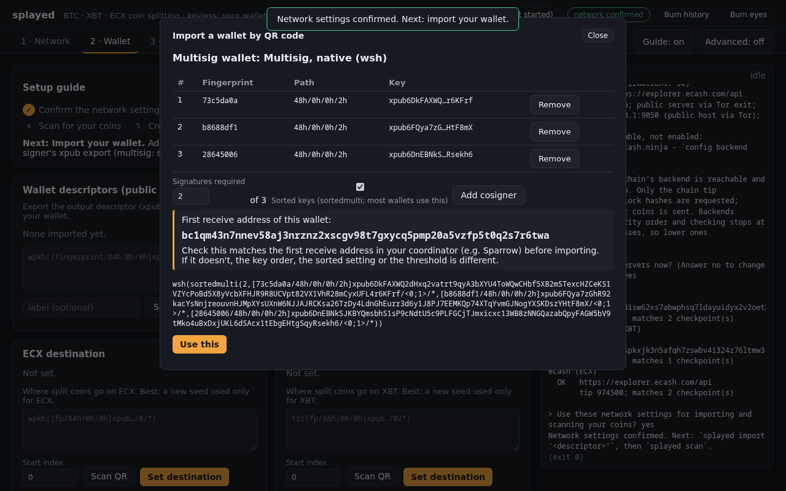
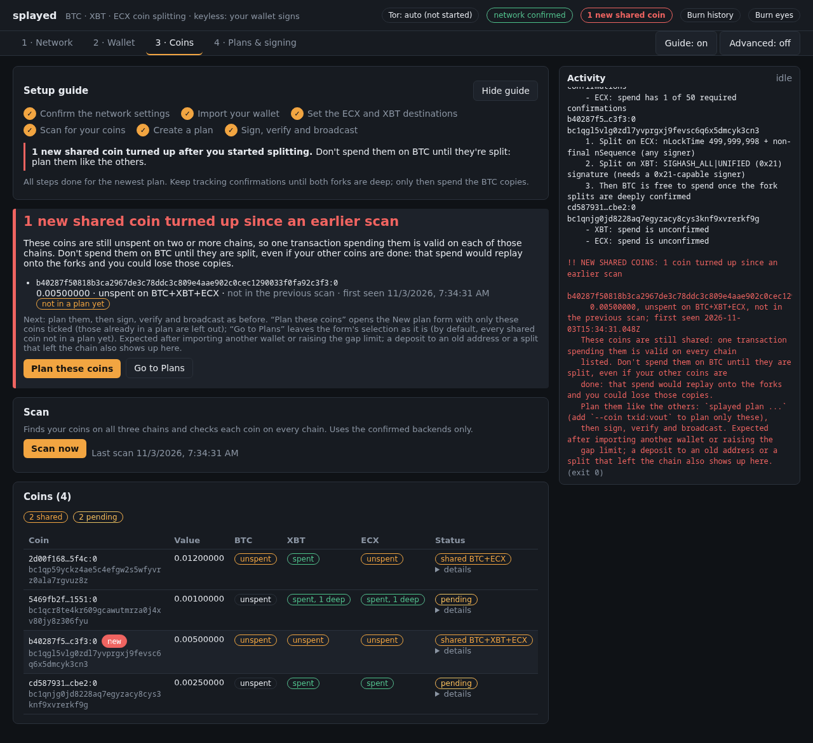
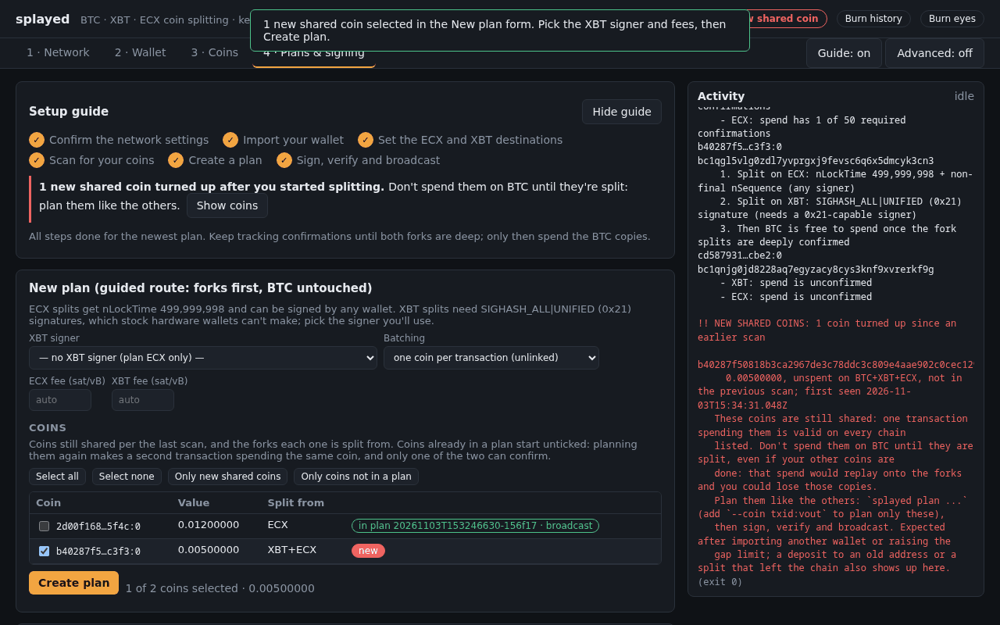
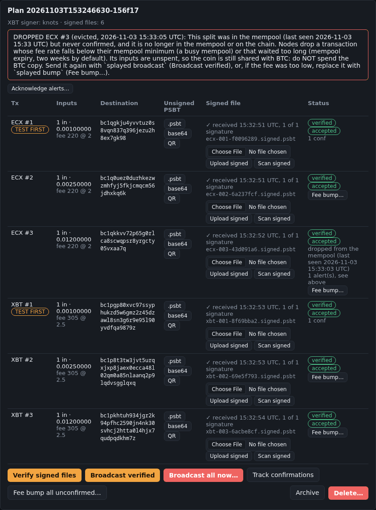
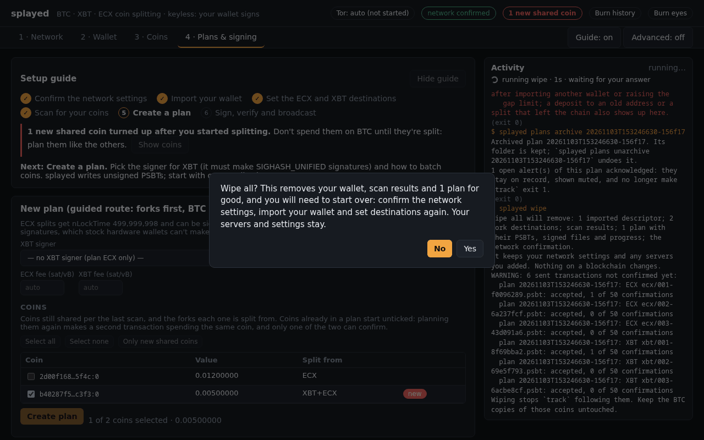
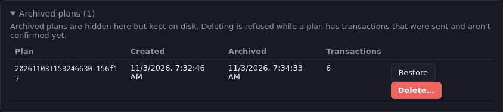
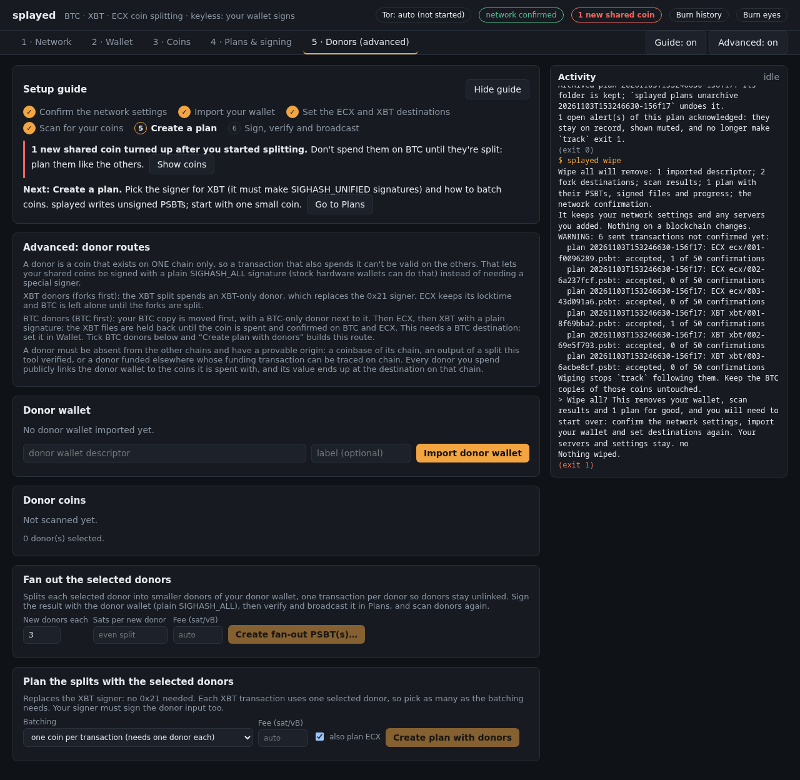

# Advanced UI guide

What the [Web UI guide](web-ui-guide.md) leaves out: multisig wallets, coins that show up in later
scans, alerts, housekeeping and the Donors tab. Read the main guide first; the step names and
numbers below refer to it.

**Contents:** [Wallet types](#wallet-types) · [Multisig](#multisig) ·
[Coins that turn up later](#coins-that-turn-up-later) ·
[Choosing coins for a plan](#choosing-coins-for-a-plan) · [Alerts](#alerts) ·
[Starting over and tidying up](#starting-over-and-tidying-up) ·
[Donors: stock hardware wallets and moving BTC first](#donors-stock-hardware-wallets-and-moving-btc-first)

## Wallet types

Supported: single-key (`pkh`, `wpkh`, `sh(wpkh)`, Taproot `tr`) and multisig (`sh`/`wsh`/`sh(wsh)`
with `multi` or `sortedmulti`).

## Multisig

**Importing (step 3).** Press **Scan QR** and, for each cosigner in turn, scan its multisig xpub
(**Add cosigner**). Set how many signatures are required, and **check that the first receive address
matches your coordinator** (for example Sparrow) before pressing **Use this**. Without a camera,
paste the QR text instead. You can also paste a multisig descriptor directly.

**Signing (step 6).** Each cosigner signs the same unsigned file, and you upload (or scan) each
one's result in turn. The signatures are combined, and the row shows how many it has ("1 of 2
signatures", "needs 1 more signature"). Verify only passes once enough cosigners have signed.
Uploading the same cosigner twice changes nothing.

On the command line, save each cosigner's file next to the original as `<name>.signed.psbt` (any
names); `splayed verify` combines the files for the same transaction.

## Coins that turn up later

When a later scan finds shared coins that weren't there before (a deposit to an old address, a coin
beyond the earlier gap limit, a split that left the chain), a red banner at the top of **Coins**
lists them, their rows get a **new** badge, and once you have a plan a pill in the header points to
them. Don't spend those coins on BTC until they are split.

**Plan these coins** on the banner opens the plan form with only those coins ticked.

## Choosing coins for a plan

In the plan form (step 5) the coin list shows the forks each coin is split from. A coin already in a
plan shows "in plan …" and whether that plan was broadcast. It starts unticked, because planning it
again makes a second transaction spending the same coin and only one of the two can confirm.

**Select all**, **Select none** and **Only new shared coins** change the pick; the line under the
list shows how many coins are picked and their value.

## Alerts

A banner above a plan's table appears when a split you sent changed after the fact:

- **REORG:** a confirmed split was re-mined or left the chain.
- **CONFLICT:** its coin was spent another way.
- **DROPPED:** it was accepted but fell out of every mempool. **Broadcast verified** sends it again
  (or replace it with **Fee bump…**).

Leave the BTC copies alone while an alert is open and read [Recovery](recovery.md). Once the split
is confirmed deep enough again, the banner turns grey and says **Resolved**. An alert that can't
resolve by itself (a stranger's spend, a dropped split you won't send again) can be muted with
**Acknowledge alerts…** once you have dealt with it; it then turns grey and says **Acknowledged**.
**Archive** acknowledges a plan's alerts too.

## Starting over and tidying up

- **Burn history**, in the header next to the theme button, starts over: it forgets your wallet,
  scan results and plans (after a question that defaults to No), resets the network confirmation,
  and keeps your servers and settings. It warns first if sent transactions are still unconfirmed.

  

- **Archive** on a plan moves it to **Archived plans** at the bottom of the tab (kept on disk;
  **Restore** brings it back). **Delete…** removes it for good, and is refused while any of its
  transactions was sent and isn't confirmed yet.

  

- **Guide: on/off** in the tab bar hides the Setup guide.
- **Burn eyes** in the header switches to a light theme (it then reads **Go back**).

## Donors: stock hardware wallets and moving BTC first

Switch **Advanced** on at the right of the tab bar to reveal a **Donors** tab.

A **donor** is a coin that exists on only one chain. Spending it in the same transaction makes the
transaction invalid everywhere else, so a normal wallet signature is enough. This lets a **stock
hardware wallet** do the XBT step, and lets you move your **BTC** copy first. Import the donor
wallet, scan it, tick donors, then **Create plan with donors**. Donors have strict origin rules and
each one publicly links the donor wallet to your coins; read
[Advanced donor routes](advanced-donor-routes.md) before using them.
