# Web UI guide

A step-by-step walkthrough of separating your coins, one wallet with a single key, using only the
browser interface.

> The screenshots use demo data on test chains, so addresses and amounts are not real. Your screens
> will show your own coins.

**Contents:** [Before you start](#before-you-start) · [1. Start the UI](#1-start-the-ui) ·
[2. Network](#2-network-decide-where-queries-go) ·
[3. Wallet](#3-wallet-add-your-coins-and-destinations) · [4. Coins](#4-coins-find-whats-shared) ·
[5. Plan](#5-plan-create-the-transactions) · [6. Sign](#6-sign-in-your-wallet) ·
[7. Verify](#7-verify) · [8. Broadcast](#8-broadcast) · [9. Track](#9-track-and-finish) ·
[If something goes wrong](#if-something-goes-wrong)

Multisig wallets, QR wallet import, alerts and plan housekeeping, and stock hardware wallets are in
the [Advanced UI guide](advanced-ui-guide.md).

## Before you start

**The problem.** Coins that existed before the 2026 forks exist on three chains: **BTC**, **XBT**
(Bitcoin BLAKE2b) and **ECX** (eCash). An ordinary spend on one chain can be copied ("replayed")
onto the others and move coins you meant to keep. splayed prepares transactions that can only be
valid on one chain, in this order:

1. **ECX** first, 2. **XBT** second, 3. **BTC** last, once the other two are safely confirmed.

splayed never sees your private keys. It builds unsigned transactions; **your own wallet signs
them**.

**You will need:**

- splayed, installed with one of the options under [Quick start](../../README.md#quick-start) in the
  README (Docker, StartOS or the release binary).
- Your wallet's **output descriptor** (an xpub-based, public-keys-only string). Export it from your
  wallet. Never paste a seed or private key; splayed refuses them.
- **Two destination wallets**, one for ECX and one for XBT, where the separated coins will go. A new
  seed for each is best. You need their descriptors too (ending in `/*`).
- A **signer** for each chain. ECX works with any wallet, including hardware wallets. XBT needs one
  that supports the `0x21` signature (see [Signers](signers.md)). If you only have a stock hardware
  wallet, see the [donor routes](advanced-donor-routes.md).

> **Not security-reviewed** (see [TODO.md](../../TODO.md)). Start with one small coin.

## 1. Start the UI

Install and start splayed as described in the [README Quick start](../../README.md#quick-start). The
release binary starts the UI with `./splayed ui`; from source, `deno task ui`. Docker and StartOS
show the UI at their own address.

On your own computer the UI opens in your browser, listens only on that computer, and the link
includes a random access token, so open it from the terminal output if it doesn't open by itself. In
[Docker](docker.md) or on another server, the page asks for the access token instead.

A **Setup guide** above every tab lists the steps below, ticks off what's done and explains the next
one.

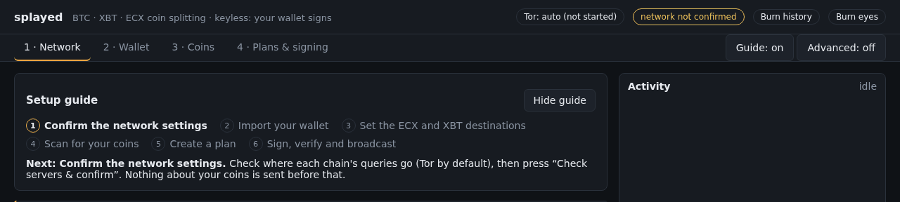

The header always shows two status pills: whether **Tor** is running, and whether your **network
settings are confirmed**. The **Activity** panel on the right shows what splayed is doing, in plain
text.

## 2. Network: decide where queries go

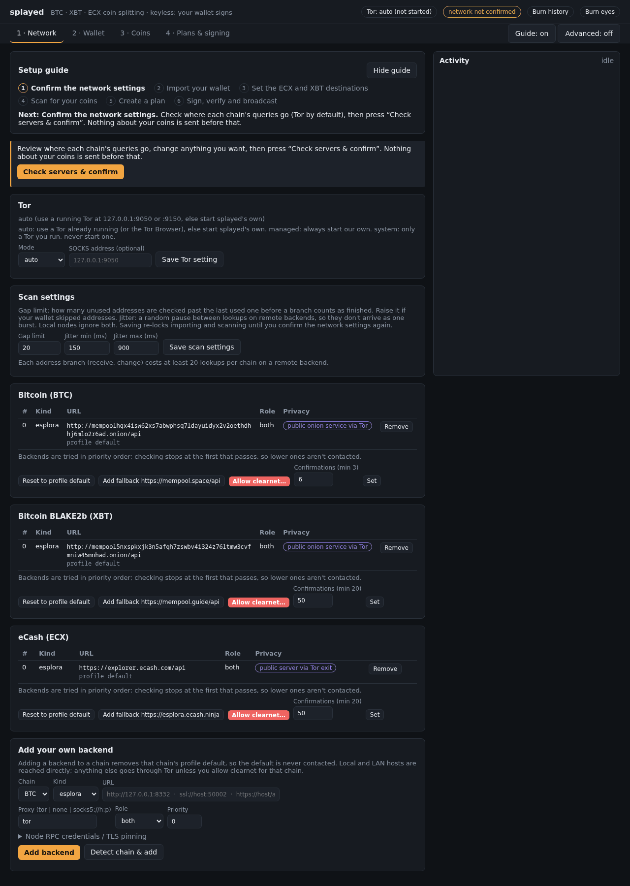

The **Network** tab shows where splayed will ask about your coins, per chain. By default it uses
public servers **over Tor**, and it will never fall back to a direct connection. The pill at top
right says **network not confirmed**, and nothing about your coins is sent until you confirm.

Most people can leave everything as it is. You can:

- change the **Tor** mode (auto, managed or system), see
  [Network and privacy](network-and-privacy.md);
- set how many **Confirmations** each chain needs before a spend counts as final;
- **Add your own backend** (a node or Electrum server you run), which replaces that chain's default.
  **Detect chain & add** asks the server which chain it follows and adds it there;
- change the **Scan settings**: the gap limit (unused addresses checked past the last used one) and
  the jitter between lookups.

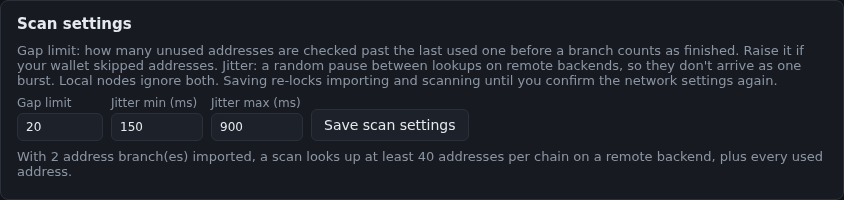

When you're happy, press **Check servers & confirm**.

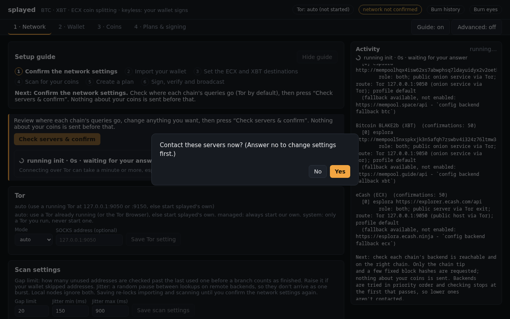

splayed asks before contacting the servers. Answer **Yes**. It then checks each server is really on
the right chain, sending only the chain tip and a few fixed block hashes, nothing about your coins.
Over Tor this can take a minute or more; a progress box shows which server is being checked.

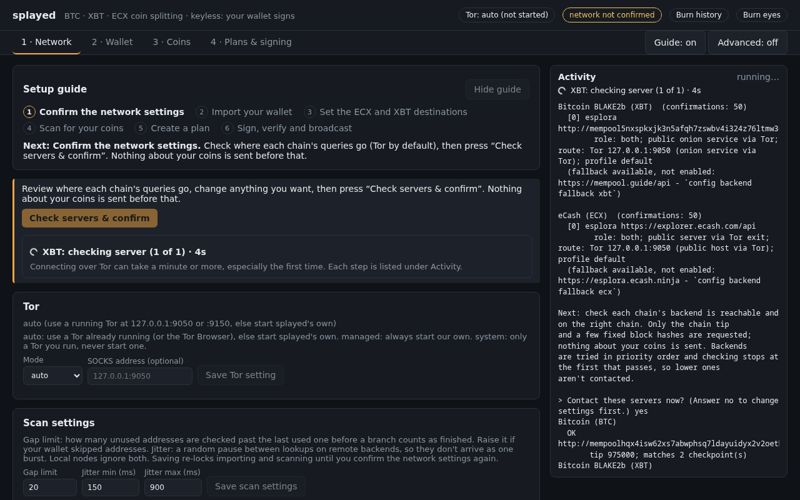

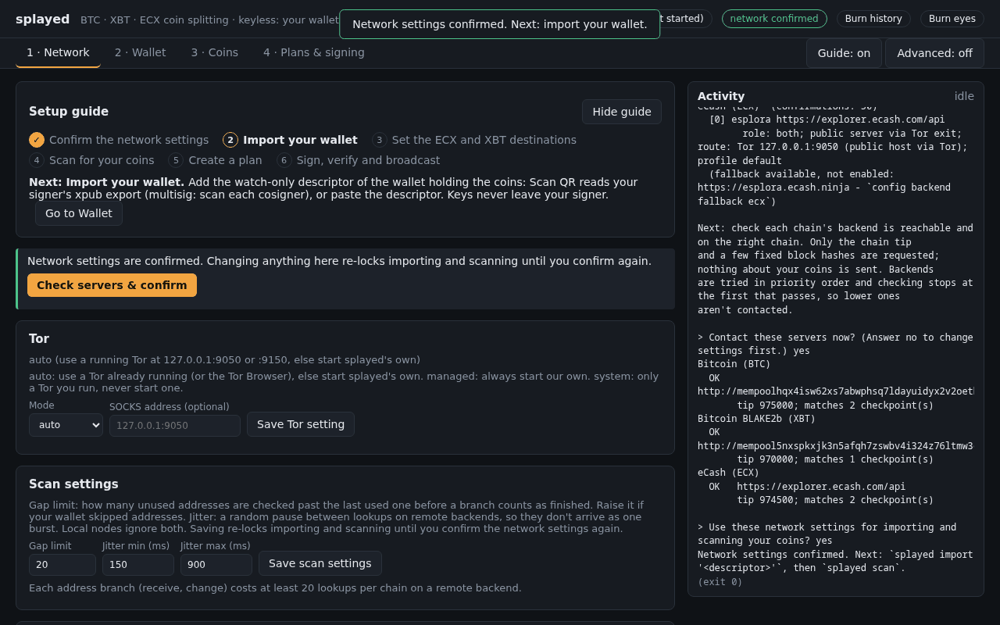

The pill turns green: **network confirmed**, and the UI moves on to the Wallet tab by itself. The
Activity panel shows which checkpoints each server matched. If a server fails the check, fix or
replace it and confirm again. Changing any network setting later locks the gate again until you
re-confirm.

## 3. Wallet: add your coins and destinations

Open the **Wallet** tab.

**Import your wallet.** Paste your output descriptor into the box, optionally add a label, and press
**Import**. Or press **Scan QR** and show it your signer's xpub export (SeedSigner: Export Xpub).

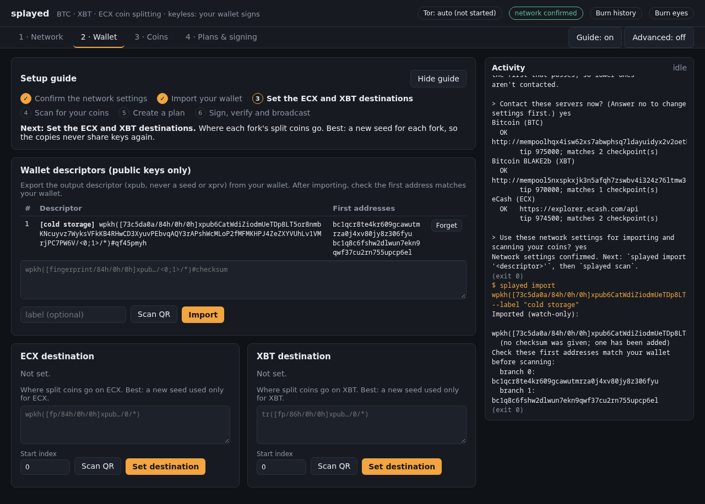

splayed lists the first addresses of the wallet. **Check that they match what your wallet shows**
before going on. If they don't, press **Forget** and re-check the descriptor.

**Set where the split coins go.** Paste the destination descriptor for ECX and for XBT into their
cards (or use **Scan QR**) and press **Set destination** on each. Once both are set, the UI moves on
to the Coins tab.

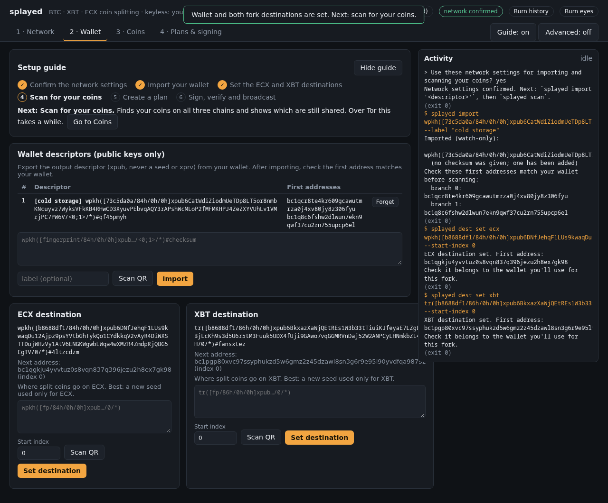

Each card then shows the next address that will be used. Use a **different wallet for each fork**,
ideally from a new seed. Every destination address is reserved so it is never reused.

## 4. Coins: find what's shared

Open **Coins** and press **Scan now**. Over Tor each address is looked up separately with pauses in
between, so a scan takes a while; a progress box shows how far it got.

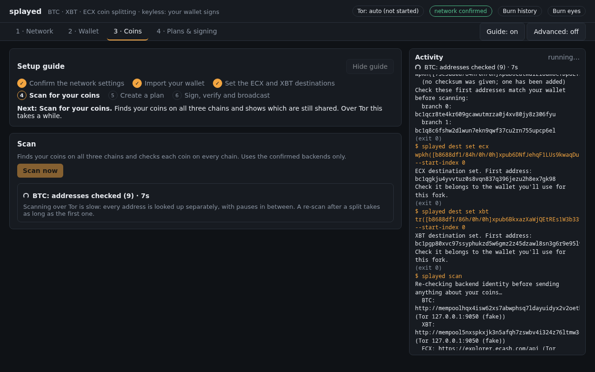

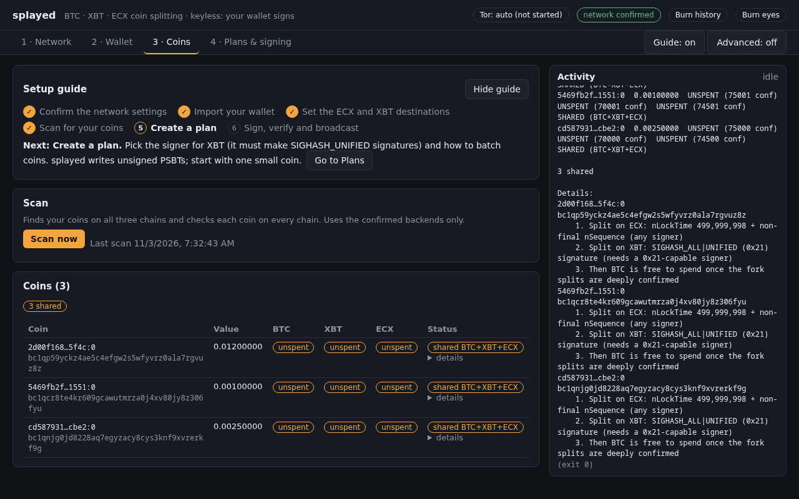

Each coin shows its state on every chain. The **Status** column tells you what to do:

| Status       | Meaning                                                                 |
| ------------ | ----------------------------------------------------------------------- |
| `shared`     | Unspent on two or more chains. These need splitting.                    |
| `separated`  | Unspent on one chain; every other copy is deeply spent or absent. Done. |
| `pending`    | A spend is unconfirmed, shallow, or its depth can't be checked. Wait.   |
| `unverified` | A chain couldn't be asked. Never treated as safe; scan again.           |
| `spent`      | Not unspent anywhere.                                                   |

Click **details** under a shared coin to see its next steps.

## 5. Plan: create the transactions

Open **Plans & signing**.

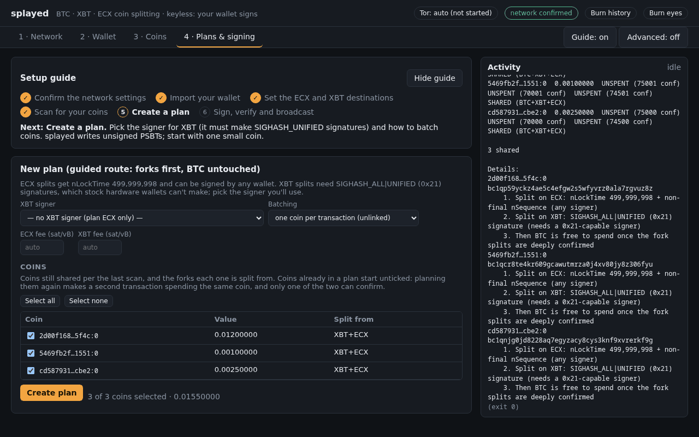

Choose:

- **XBT signer:** the wallet you will use for XBT. This shapes the file for that signer. Pick "no
  XBT signer" to plan ECX only.
- **Batching:** _one coin per transaction_ keeps your coins unlinked (recommended). The other
  options combine coins into fewer transactions, which publicly links their addresses.
- **Fees (sat/vB):** leave blank for an automatic estimate, or set your own per chain.
- **Coins:** the coins that are still shared. Every coin that isn't in a plan yet starts ticked;
  untick the ones to leave for later.

Press **Create plan** (it stays disabled, with the reason, while no coin is picked). splayed
re-checks each coin, fetches its previous transaction, and writes one unsigned file (PSBT) per
transaction.

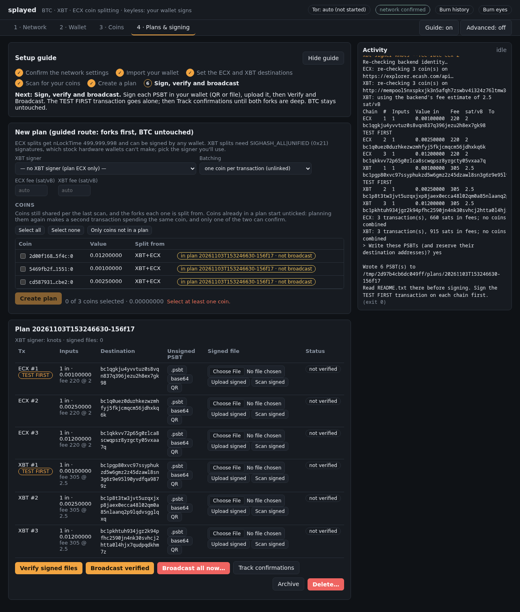

The table lists every transaction, with its value, fee and destination. The smallest transaction on
each chain is marked **TEST FIRST**: it is sent alone first, as a safety check.

## 6. Sign in your wallet

For each row, get the unsigned file to your signer. There are three ways:

- **`.psbt`** downloads the file. Open it in your wallet (for example, "open transaction from
  file").
- **`base64`** downloads the same data as text, for wallets that paste instead.
- **QR** shows the transaction as an animated QR code for an **air-gapped signer** (Keystone,
  Passport, Jade, SeedSigner and others).

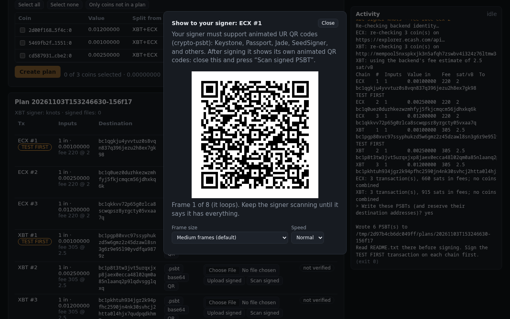

Keep the signer scanning until it has all frames. If it misses some, nothing is lost: frames loop.

**Use the right signer for each chain.**

- **ECX rows:** any wallet can sign.
- **XBT rows:** the wallet must support the `0x21` signature. A signer that signs normally instead
  will be caught at the verify step.

Then bring each **signed** transaction back:

- **Choose File** and **Upload signed** for a saved file. Signed PSBTs and raw transaction hex are
  both accepted.
- **Scan signed** reads your signer's animated QR codes through the camera. Browsers only allow the
  camera on `localhost`, `127.0.0.1` or an HTTPS address, so open the UI at one of those.

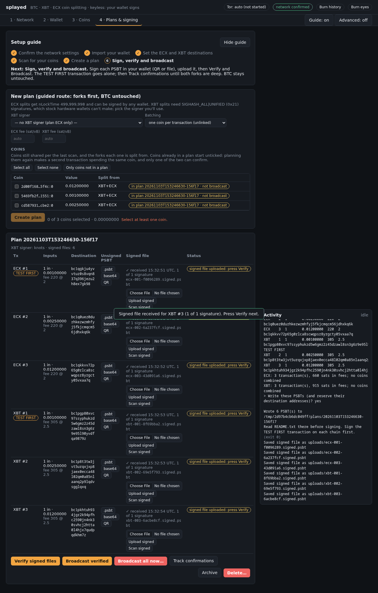

Each uploaded row shows a green **received** note. Do all rows before verifying.

## 7. Verify

Press **Verify signed files**.

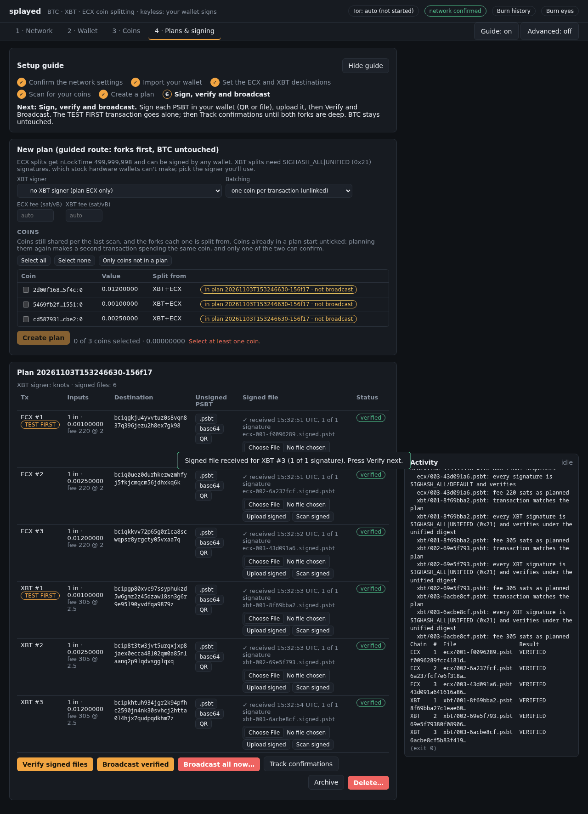

splayed checks, for every transaction, that:

- it is exactly the transaction that was planned (nothing swapped or re-fee'd by the signer);
- the chain's replay protection is intact;
- every signature is valid on its own chain;
- the fee matches the plan;
- if you use your own nodes, the target chain accepts it and the others reject it.

Rows turn **verified**. If any row fails, the Activity panel says why. Fix the cause and upload that
file again. Nothing is sent until you move on.

## 8. Broadcast

Press **Broadcast verified**. splayed asks for confirmation:

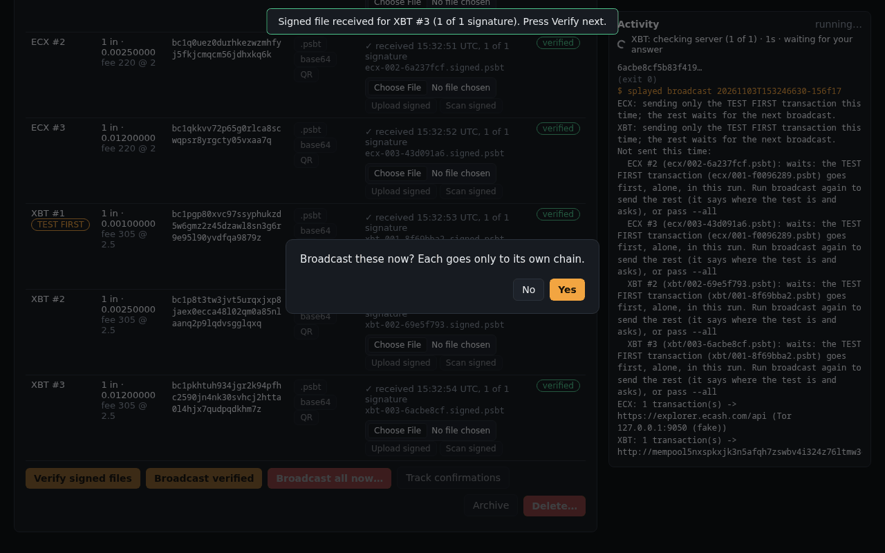

Each transaction goes **only to its own chain**, over its own Tor connection. The first time, only
the **TEST FIRST** transaction on each chain is sent.

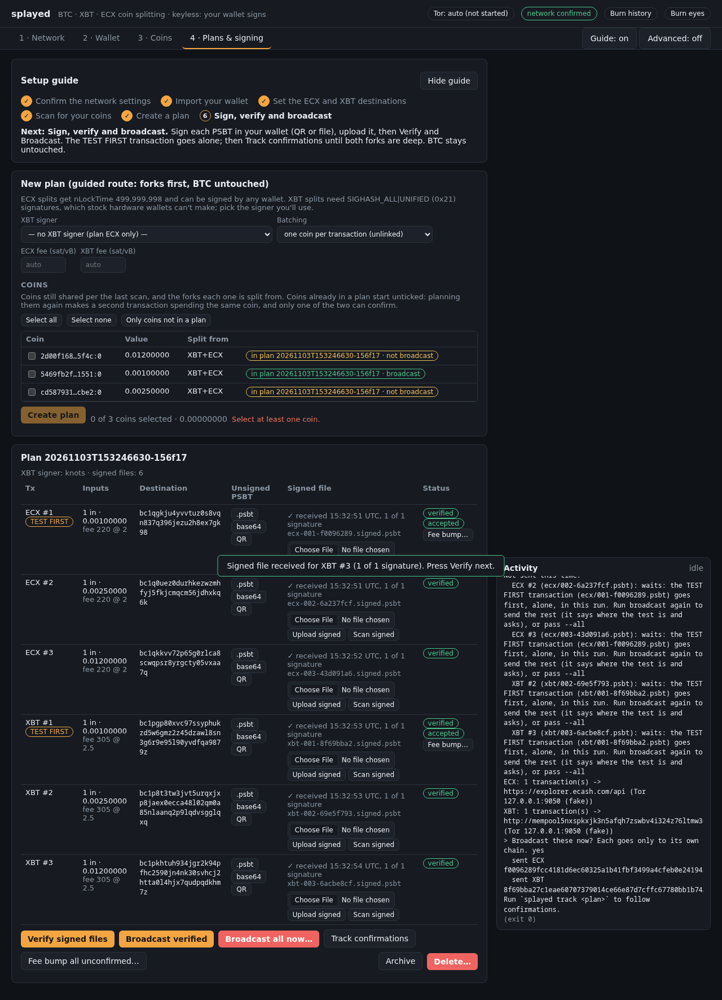

Wait for the test transactions to confirm on their chains (**Track confirmations**), then press
**Broadcast verified** again. splayed says where each TEST FIRST transaction is now and asks before
sending the rest: answer **Yes** once it is confirmed (you can also answer yes earlier; that is your
call), **No** to wait. If the TEST FIRST transaction has **not** gone out at all (not verified,
rejected, in conflict, superseded by another plan…), the question says so first and **No** is the
default button: sending the rest then skips the test.

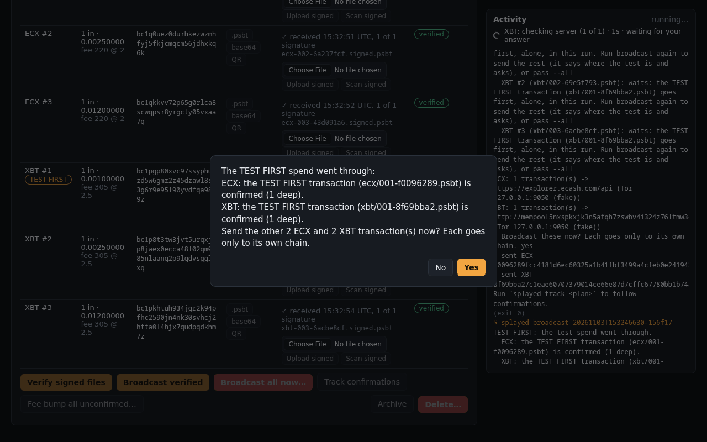

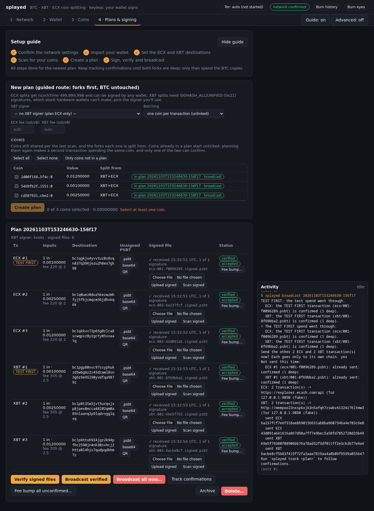

If a send times out you'll see an _unknown_ result, never a false failure; pressing the button again
is safe and never double-sends. A split that was sent but dropped out of the mempool shows a
**DROPPED** alert and is sent again by **Broadcast verified** (or replace it with **Fee bump…**);
see [Recovery](recovery.md#dropped-from-the-mempool). **Broadcast all now…** skips the TEST FIRST
step; avoid it until you are comfortable.

## 9. Track and finish

Press **Track confirmations** now and then.

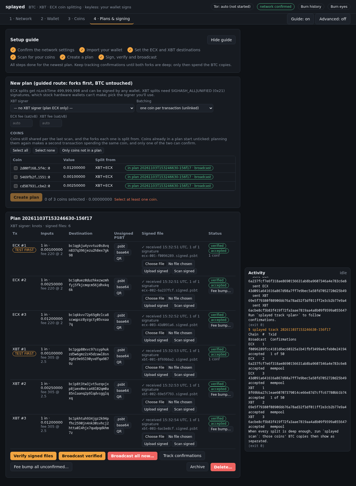

Each row shows its depth against the number you chose on the Network tab. When all splits are deeply
confirmed, go to **Coins** and **Scan now** again. The BTC copies now show as **separated**, and can
be spent normally from your original wallet.

**Until then, don't spend the BTC copies.**

## If something goes wrong

- **A banner appears above the table saying REORG, CONFLICT or DROPPED.** A split you sent changed
  (re-mined, dropped, or its coin was spent another way). Leave the BTC copies alone and read
  [Recovery](recovery.md#reorgs); alerts are explained in the
  [Advanced UI guide](advanced-ui-guide.md#alerts).
- **A transaction is stuck unconfirmed.** Use **Fee bump…** on its row to create a higher-fee
  replacement. Sign, verify and broadcast the new plan exactly as above. See
  [Recovery](recovery.md#stuck-transactions-fee-bump-rbf).
- **A coin stays `pending` or `unverified`.** Wait and scan again; if it persists, the server can't
  report enough detail. Adding a node with `txindex=1` helps (see
  [Network and privacy](network-and-privacy.md#using-your-own-nodes)).
- **Verify says a signature isn't `0x21`.** Your XBT signer ignored the request. Use one from
  [Signers](signers.md).
- **Something else:** multisig wallets, coins that show up in a later scan, starting over, archiving
  plans and the Donors tab are in the [Advanced UI guide](advanced-ui-guide.md).

## Related

- [Advanced UI guide](advanced-ui-guide.md): multisig, alerts, housekeeping, donors.
- [Web UI reference](web-ui.md) for the security model of the interface.
- [Signers](signers.md), [Network and privacy](network-and-privacy.md), [Recovery](recovery.md).
- The same steps from the command line: [User guide](guide.md).
